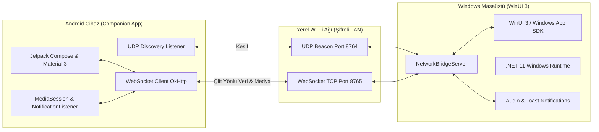

# PhoneBridge 🚀

[](https://github.com/karacaogluomer55-coder/PhoneBridge)
[](https://github.com/karacaogluomer55-coder/PhoneBridge)
[](https://github.com/karacaogluomer55-coder/PhoneBridge)
[](LICENSE)
[](PhoneBridge-Setup.exe)

> **PhoneBridge**, Android akıllı telefonunuz ile Windows 10/11 bilgisayarınız arasında hiçbir bulut sunucusuna ihtiyaç duymadan, tamamen yerel Wi-Fi ağı üzerinden ultra düşük gecikmeli köprü kuran modern, açık kaynaklı bir cihaz entegrasyon ekosistemidir.

---

## 🌟 Öne Çıkan Özellikler

### 📱 1. Sıfır Yapılandırma ve Otomatik LAN Keşfi (Zero-Config)
- **Manuel IP Girişine Son:** Bilgisayar ve telefon aynı Wi-Fi ağına bağlı olduğu anda UDP broadcast (`port 8764/8765`) aracılığıyla birbirini saniyeler içinde bulur.
- **Tek Tıkla Eşleşme:** Bulunan cihaza dokunulduğu anda güvenli WebSocket bağlantısı kurulur.

### 🎵 2. İki Yönlü Telefon Medya Denetimi (Android 17 Material You)
- **Telefonda Çalan Medyayı Windows'tan Yönetme:** Spotify, YouTube, Apple Music veya herhangi bir oynatıcıda çalan parçanın başlığı, sanatçısı, albüm adı ve **yüksek çözünürlüklü albüm kapağı** Base64 üzerinden Windows masaüstüne canlı aktarılır.
- **Tam Denetim:** Oynat/Duraklat, Önceki/Sonraki parça geçişi ve ses düzeyi doğrudan PC'den kontrol edilir.
- **Android Arayüzü:** Android tarafında modern Material You (Android 13–17) tarzı dalga çubuğu, yuvarlatılmış albüm kartı ve canlı denetimler bulunur.

### 💬 3. Gerçek SMS Sohbetleri & Bildirim Yanıtlama
- **Rehber ve Mesaj Entegrasyonu:** Telefondaki en son SMS konuşmaları kişi adlarıyla birlikte listelenir.
- **Doğrudan Yanıt:** Windows üzerinden mesaj yazıp tek tıkla telefondan SMS olarak gönderebilme.
- **Native Windows Toast:** Gelen mesaj ve aramalarda yerel Windows bildirimleri ve satır içi hızlı yanıt desteği.

### 📞 4. Telefon Çağrı Yönetimi & Audio Ducking
- Gelen aramalarda PC ekranında şık bir pop-up penceresi açılır.
- Arama sırasında PC'de çalan müzik veya video sesi otomatik olarak kısılır (Audio Ducking) ve arama bittiğinde eski düzeyine döner.

### 📂 5. Çift Yönlü Dosya & Pano (Clipboard) Senkronizasyonu
- Telefonda kopyalanan metin anında PC panosuna, PC'de kopyalanan metin tek dokunuşla telefona aktarılır.
- Fotoğraf, video ve belgeleri sürükle-bırak veya tek tıkla yerel ağ üzerinden kablosuz olarak aktarma.

### 🖱️ 6. Uzaktan Giriş & Sunum Kumandası
- Telefon ekranını dizüstü bilgisayar touchpad'i gibi kullanarak fareyi yönetme.
- PowerPoint / PDF slaytlarını telefondan ileri-geri yönetebilme.

---

## 🏗️ Mimari & Teknoloji Yığını



| Bileşen | Windows İstemcisi | Android İstemcisi |
|---|---|---|
| **Kullanıcı Arayüzü** | WinUI 3 (Windows App SDK 2.6.5, XAML) | Jetpack Compose (Material 3) |
| **Çalışma Zamanı** | .NET 11 Windows (win-x64) | Android SDK 35 (Android 8.0 - 17) |
| **Ağ Protokolü** | RFC 6455 WebSocket Server & UDP Beacon | OkHttp 4 WebSocket Client & UDP Socket |
| **Bildirimler** | Windows Native AppNotifications | NotificationListenerService |
| **Ses & Medya** | NAudio, CoreAudio API | MediaSessionManager, AudioDuck |

---

## 🚀 Kurulum (Tek Tıkla)

### Windows İçin:
1. Depodan [PhoneBridge-Setup.exe](PhoneBridge-Setup.exe) dosyasını indirin.
2. Çift tıklayarak çalıştırın ve **"Kurulumu Başlat"** butonuna basın.
3. Uygulama otomatik olarak `%LocalAppData%\Programs\PhoneBridge` dizinine kurulur, Masaüstü ve Başlat Menüsü kısayollarını oluşturur ve uygulamayı başlatır.

### Android İçin:
1. [PhoneBridge-Android.apk](PhoneBridge-Android.apk) dosyasını telefonunuza indirin ve yükleyin.
2. Uygulamayı açtığınızda bilgisayarınız listede otomatik olarak belirecektir; üzerine dokunarak anında eşleşin!

---

## 🛠️ Kaynak Koddan Derleme

### Windows Projesi:
```bash
cd PhoneBridge
dotnet build -c Release -r win-x64
```

### Android Projesi:
```bash
cd PhoneBridge/AndroidCompanion
./gradlew assembleRelease
```

---

## 👥 Katkıda Bulunanlar (Contributors)

- **Ömer Faruk Karaca** ([@karacaogluomer55-coder](https://github.com/karacaogluomer55-coder)) - Kurucu ve Baş Geliştirici
- **PhoneBridge Açık Kaynak Topluluğu** - Katkıda bulunanlar ve test ekibi

---

## 📄 Lisans

Bu proje [MIT Lisansı](LICENSE) kapsamında korunmaktadır.
